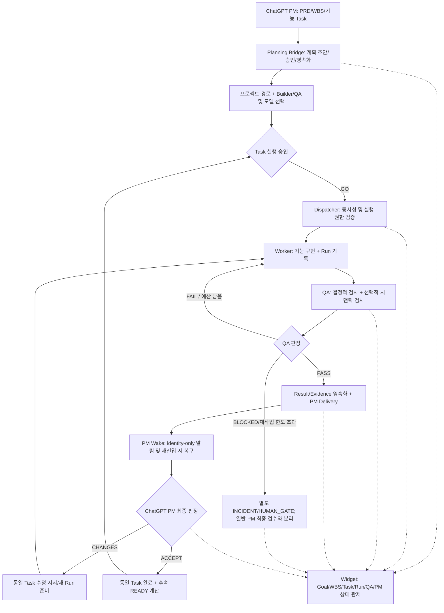
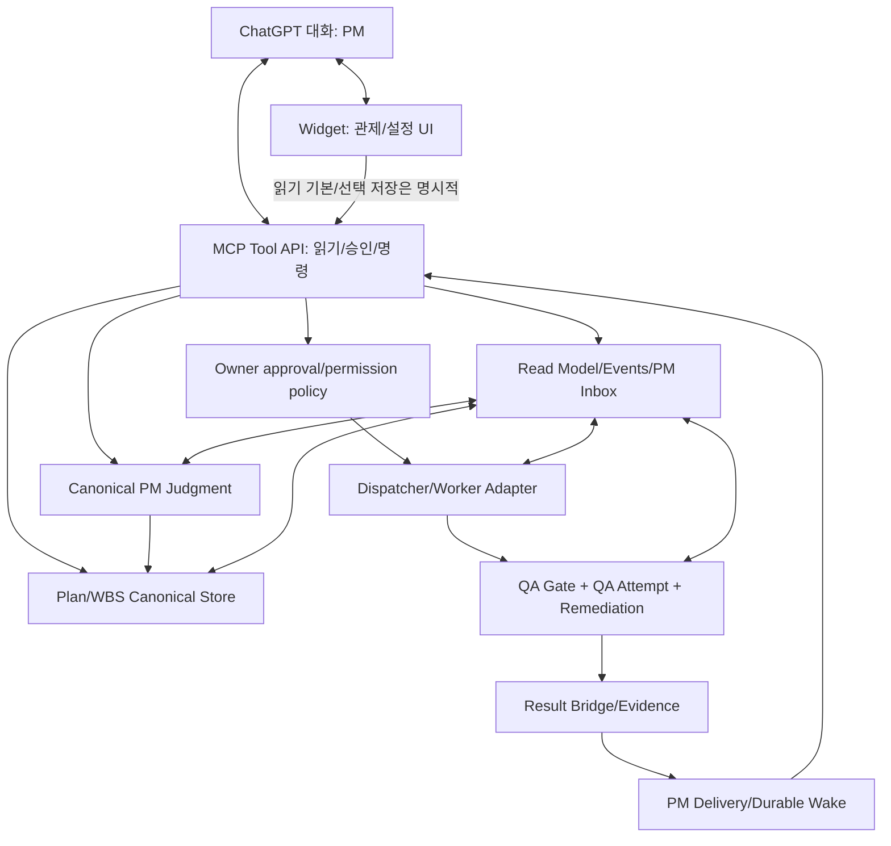

# JuRelay — ChatGPT PM Native Engine Rebaseline v0.4

**작성 기준:** 2026-10-18 · **성격:** 설계/감사 초안 · **Founder 확정:** MCP+Widget 중심, ChatGPT PM 최종 승인, 기능 단위 Task, QA FAIL은 동일 Task Worker 재작업, QA PASS 결과에 한해 일반 PM 결과 검수, Widget 관제.  
**실행 상태:** 구현 승인·파일 변경·아카이빙·Task 실행 없음.  
**GitHub 읽기 전용 기준:** `ju0o/JuRelay`, `ar/chatgpt-goal-relay`, HEAD `b9473f5438f7e4ec2b4679b6e148d516de45eb76`.

## 1. 제품 계약

JuRelay의 유일한 최종 Task 판정자는 ChatGPT PM이다. JuRelay는 연결·승인 검증·전달·영속 상태·복구를 담당하고, Worker는 구현, QA는 1차 품질 검증을 담당한다. Widget은 현재 Goal/WBS/Task/Run/QA/PM 상태의 관제 표면이며 판정을 생성하지 않는다. JuCrew는 별도의 다중 CLI-Agent 하네스이며 V1 실행 필수 의존성이 아니다.

### 업무 루프

**QA FAIL → ChatGPT 일반 심사 금지**, 예외 개입 알림은 별도 채널. QA PASS ≠ PM ACCEPT. PM ACCEPT 후 다음 Task는 READY로 준비하되 Task별 실행 허가 계약을 새로 확정하기 전 자동 실행하지 않는다.

## 2. 구현 계층

UI는 표시된 상태만 믿지 않고 MCP의 정본 재검증을 따라야 한다. Tool은 UI 없이도 정상 동작해야 한다.

## 3. Task 설계 규칙

- Goal = 사용자가 달성하고자 하는 결과, WBS = 기능/단계 묶음, Task = 독립적으로 구현·검증 가능한 기능 결과물, Run = 동일 Task 실행 시도, QA Attempt = 해당 Run의 검증, PM Judgment = 최종 판정.
- 잘게 나누는 대상은 Worker 내부 체크리스트; PM 승인 Task는 '로그인 기능', '회원가입', '비밀번호 재설정' 정도로 기능적 결과물.
- Task는 입력/출력, 허용 변경 범위, Acceptance Criteria, 결정적 테스트, 시맨틱 QA 필요 여부, 의존성, 비용/재시도 상한을 가진다.
- Task가 여러 사용자 결과를 혼합하거나 테스트 가능 범위를 넘어서면 분할한다. 단순 파일 편집/버튼 색 변경만으로 Task를 자동 생성하지 않는다.
- ChatGPT가 현재 대화의 기획을 구조화하여 MCP에 넘겨야 하며 MCP가 대화 전체를 임의 수집하는 구조로 가정하지 않는다. 확정·수정은 계획 diff와 사람 확인 후 정본 반영.

## 4. 기존 코드 근거 및 판정

| 현 코드 (개발 브랜치) | 실재 역할/문제 | 권고 |
|---|---|---|
| `src/backend/goal-task.ts`, `goal-task-runtime.ts`, `execution-plan.ts` | 정본 Task/Plan/상태 저장 | KEEP_CORE; 기능 단위 WBS 계약 강화 |
| `goal-planner.ts`, `goal-intake.ts` | 별도 Codex 플래너, Plan Draft 최대 8 Task | REFACTOR; ChatGPT-origin 정본 기획을 우선하고 8개 한계를 전체 WBS에 강제하지 않기 |
| `task-execution-config.ts`, `agent-model-catalog.ts` | Task별 Builder/모델 명시 선택 및 동결 | KEEP; 프로젝트 기본값+Task 스냅샷 승인 간 UX 일치 |
| `v1-dispatch.ts`, `dispatcher.ts` | 단일 GO/중복 실행 방지/Run 실행 | KEEP_CORE; 다음 Task 무단 실행 불가 |
| `qa-contract.ts`, `qa-gate.ts`, `qa-attempt.ts` | QA 검사, 실패 후 같은 Task 재작업 | KEEP/CRITICAL_FIX; QA PASS-only 일반 PM Delivery |
| `result-bridge.ts` | QA 계약 유무에 따라 게이트 또는 직접 PM Delivery | CRITICAL_FIX; 신규 V1 Task QA 계약 누락 차단, 레거시 호환성 분리 |
| `pm-delivery.ts`, `pm-wake.ts`, `pm-judgment.ts` | Identity-based Delivery, bounded Wake, 최종 PM ACCEPT/CHANGES | KEEP_CORE; PASS 증명 바인딩/장애 알림 분리/재진입 |
| `auto-advance.ts` | `qa-pass → dispatch-next` 결정을 만들 수 있음 | CRITICAL_AUDIT; PM 승인 전 Task 진도/Run 진행 금지 |
| `execution-plan-continuation.ts` | PM ACCEPT 뒤 frozen successor를 자동 dispatch하는 코드 경로 존재 | CRITICAL_FIX; 승인된 연속 실행 모드 없는 경우 READY까지만 |
| `pm-widget-resource.ts` | 관제·실행·진단이 한 4천 줄대 HTML/JS에 결합 | REFACTOR; 경량 WBS 관제와 준비 패널 분리 |
| Electron `src/frontend`, `src/backend/main.ts`, TUI | 이전 독립 UI | DEFER_PRESERVE; 참조 감사 전 삭제 금지 |

### 코드와 목표 사이의 명시적 충돌

1. **[P0] QA FAIL 한도초과/BLOCKED**: `qa-gate.ts`는 일반 PM Delivery를 생성 가능하다. 요구 계약은 정상 PM 최종 심사에 QA PASS만 보내며, 불능 상태는 별도 INCIDENT 알림으로 처리.
2. **[P0] QA 계약 미설정 Task**: `result-bridge.ts`는 기존 호환 경로에서 QA 없이 PM Delivery 가능. 신규 V1 Task에는 필수 검증 계약 게이트 도입.
3. **[P0] 다음 Task 자동 실행**: `execution-plan-continuation.ts`는 ACCEPT 후 다음 Task dispatch. 명시적 GO와의 일치성 정리.
4. **[P1] 자동 진행 결정 중복**: `auto-advance.ts`의 QA PASS→`dispatch-next`, QA FAIL 2차→human 규칙과 `qa-contract.ts`의 기본 재작업 2회 등 예산/권한 정책을 통합해야 함.
5. **[P1] Host Wake 한계**: mounted Widget의 `ui/message`가 닫힌 ChatGPT 대화까지 능동적으로 깨우는 것을 보장하지 않음. 영속 Inbox/재진입 복구 필수.
6. **[P1] Task별 QA Agent+모델 선택 부족**: 현재 `qaContract.semantic.qaWorkerId`는 있으나 Builder와 동등한 모델 선택/동결 UI·계약은 미완성.
7. **[P1] 계획 버전/컨텍스트**: 대화에서 논의한 WBS가 새 채팅·새 연결에서 정본과 달라질 위험. 계획 ID/버전/해시, 변경 diff/승인 필요.
8. **[P2] UI 복잡성·데이터 스코프**: Widget에서 프로젝트/Goal/Task의 정본 출처와 실행 상태를 명확히 표현하고 global inbox와 프로젝트 조회를 분리.
9. **[P2] OSS 호환성**: 사용자별 CLI/모델 인증, 설치, MCP Host 지원, 무료 모델의 할당량 차이를 명확히 표시.

## 5. Widget 정보 구조 (제안)

- **홈: 관제** — 프로젝트 선택, 현재 Goal/WBS, 기능별 Task 트리, 진행/재작업/검수/보류, 한 개의 '다음 행동'. 기본은 읽기 전용.
- **작업 상세** — 기능 목표, AC, 선행 관계, Run 이력, 현재 Worker·QA 모델, QA 평가 내역, PM 판정, Evidence 링크. 자동으로 저장·승인·실행하지 않는다.
- **준비(초기 1회)** — 프로젝트 작업 폴더, 설치된 Builder·QA, 각 모델 카탈로그 조회 및 명시적 선택, 인증/무료 여부 표시. Task 실행 시 바인딩 재검증.
- **활동/수신함** — 최근 이벤트, PM이 검토할 QA PASS Result, 실패한 QA 로컬 재작업, 한도 초과 INCIDENT. 서로 다른 큐를 합치지 않는다.
- **고급/진단** — 경로·에이전트 환경, 레거시 세부 실행, 디버그. 개발 기본 화면에서 제외.

## 6. 단계별 이행 및 Gate

| 단계 | 산출물 | 종료 기준 |
|---|---|---|
| RB-01 | 읽기 전용 코드 의존성·파일 분류 감사 | KEEP/REFAC/ARCHIVE 후보에 코드 사용 근거, Git SHA, 백업 정책 |
| RB-02 | 이 문서의 제품·QA·PM·승인 계약 Founder 확정 | PASS/FAIL/INCIDENT/Wake/후속 Task 승인 정책 명문화 |
| RB-03 | QA/PM/재시도/연속 실행 P0 계약 수정 | FAIL→동일 Task, PASS→1 PM Delivery, ACCEPT→다음 READY, QA 없는 신규 Task fail-closed |
| RB-04 | ChatGPT 대화→기능 WBS 정본화 | Draft/검수/승인/생성/버전 동기화 복구 E2E |
| RB-05 | Worker+QA Agent/모델 선택 및 고정 | 실제 카탈로그/인증·실행 모델·독립 QA 검증 |
| RB-06 | 단일 기능 Task 완전 E2E | QA FAIL→재작업→PASS→Wake→PM CHANGES/ACCEPT→다음 READY |
| RB-07 | Widget 관제 리디자인 | 320/380/540, Light/Dark, Task 귀속·진행·모델 출처, Host QA |
| RB-08 | 재시작/새 채팅/Inbox/Wake 복구 | 중복 실행·중복 판정 0, 로컬 재시작/Host 부재 시 검토 보존 |
| RB-09 | 선택적 Private Archive 및 OSS Release | 삭제 없는 스냅샷, 민감정보 감사, 라이선스, 설치/복구, 공개 릴리스 기준 |

**금지:** 이 설계 문서 자체는 코드 수정/아카이빙/Worker GO를 허가하지 않음.

## 7. 필수 계약 시험

- F1: 기능 Task 1개 안에서 QA FAIL 후 PM 일반 Delivery 0, 같은 Task의 새로운 Run 1개, QA 재검사.
- F2: 재시도 예산 초과/QA BLOCKED일 때 Worker 무한 루프 0, 정상 PM 최종 검수 알림 0, 별도 INCIDENT 기록.
- F3: QA PASS 뒤 신뢰 가능한 Result/Evidence+QAAttempt 바인딩으로 PM Delivery 정확히 1개. ChatGPT PM만 ACCEPT 가능.
- F4: PM CHANGES 뒤 같은 Task/새 Run으로 재작업·재QA 후 새 Result.
- F5: PM ACCEPT 뒤 다음 READY는 가능하지만 승인 없는 새 Worker Run 0.
- F6: 신규 QA 계약 누락 Task는 시작/PM Delivery fail-closed; 레거시 Task는 별도 호환 정책 아래 보존.
- F7: ChatGPT 호스트 종료/재진입, MCP·런타임 재시작, 프로젝트 전환, 병렬·중복 Wake 시에도 현재 결과·승인 이력 유지.
- F8: Builder·QA 모델 자격/무료 모델 정책·비용 선택의 변동/실패 시 임의 대체 모델 실행 0.
- F9: 기능 크기로 구성된 WBS가 단계별로 갱신되고, 미승인 계획 수정이나 Goal/Task 중복 생성 0.

## 8. 배포·코드 보존

JuRelay는 로컬 Self-hosted MIT 계열 OSS 후보(라이선스와 서드파티 의무 재검증 필요). AI·ChatGPT 이용료는 사용자의 계정·모델·장비가 부담한다. V1에 JuCrew 및 공용 중앙 서버는 불필요하다. Electron/TUI와 과거 프로토타입은 의존성 증명 전 삭제하지 않으며, Private Archive를 만들기 전 실행 증거·영속 데이터·민감정보 분리 및 Founder 승인 필요. 현재 공개 `main`과 MCP 개발 브랜치가 분리되어 있고, PRD 문서는 공개 릴리스 승인 전에 동기화해야 한다.